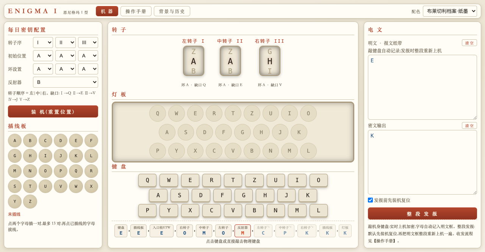

# Enigma I 恩尼格玛模拟器

[](https://github.com/Louvane/enigma/actions/workflows/ci.yml)
[](LICENSE)
[](https://adoptium.net)

恩尼格玛 I 型的忠实模拟:Java 物理组件建模 + Vue 3 可视化操作台 + 百科级背景文档。
经四组公开历史向量逐字节验证,与 1941 年德军制式机行为完全一致。



## 特性

- **物理组件级建模**:转子(接线/环设置/缺口)、反射器 B/C、插线板(最多 13 对)、ETW,一类一物
- **真实机械行为**:先步进后通电、缺口进位、**双步进异常**(ADU→ADV→AEW→BFX)
- **完整报文规程**:日钥装机 → 报文密钥(QWE/RTZ/EWG)→ 发报 → 收方镜像解密,全流程可在页面复现
- **可视化**:转子鼓转动、灯板亮灯、12 站信号路径、插线板连线
- **四套主题**:胡桃木黄铜 / 仪表绿 / 潜航红铜 / 档案纸墨,一键切换记忆
- **内置文档**:三分钟上手操作手册 + 百科级背景与历史(破译史时间线、人物志)

## 快速开始

要求:JDK 17+、Maven 3.6+

```bash
./run.sh            # 构建 + 测试 + 启动,默认 8080
./run.sh 9090       # 指定端口

# 或标准 Maven 流程
mvn test            # 运行历史向量测试(JUnit 5)
mvn package         # 打包 target/enigma.jar
```

浏览器打开 http://localhost:8080

## 验证

| 配置 | 操作 | 期望 |
|---|---|---|
| I II III / 环AAA / 位置AAA / B / 无插线 | 敲 5 个 A | `BDZGO` |
| 同上,环 BBB | 敲 5 个 A | `EWTYX` |
| I IV III / 环PZH / 插线10对 / 位置QWE | 敲 RTZ | `EWG`(维基百科 Aachen 战报)|

全部向量可在页面【操作手册 → 检验向量】一键装载复现;CI 每次构建自动跑同套测试。

## 项目结构

```
pom.xml              Maven:运行时零第三方依赖,仅测试期 JUnit 5
src/main/java/       core(纯机械层,不依赖 IO)+ server(HTTP 层)
src/test/java/       JUnit 5 历史向量测试
web/                 Vue 3 前端(零构建,库已本地化)
docs/                截图
```

## 技术要点

- **零构建前端**:Vue 3 全局构建 + 手写 JS 模板,无 Node 依赖;第三方库本地化
- **单一状态源**:手动敲键与整段发报共用 `press()` 出口,与真实操作语义一致
- **API**:`GET /api/state`、`POST /api/config`、`POST /api/keypress`(query 参数,统一错误结构)
- **静态资源安全**:路径规范化 + 前缀校验,防目录穿越

## 许可

[MIT](LICENSE) — 仅供学习密码学历史与教学演示。如恩尼格玛本身所示,它**不是**安全加密方案。
